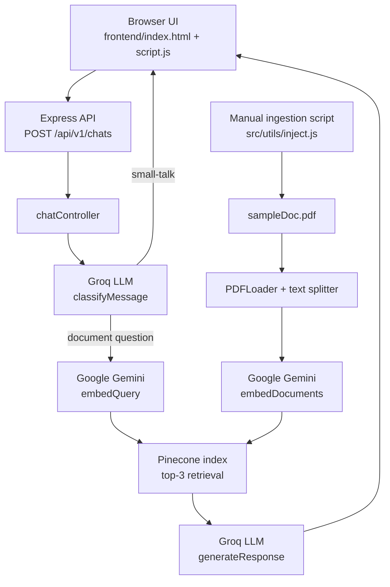

# Askfolio

Askfolio is a document question-answering chatbot. It indexes a sample PDF in
Pinecone, retrieves relevant text for document questions, and uses an LLM to
generate an answer. Simple social messages are classified and answered without
embedding the message or querying Pinecone.

## What the project currently does

- Loads `backend/public/files/sampleDoc.pdf` through a manual ingestion script.
- Splits the PDF text into overlapping chunks and creates Google Gemini
  embeddings for each chunk.
- Uploads the chunks and vectors to a configured Pinecone index.
- Provides a `POST /api/v1/chats` endpoint for chat requests.
- Uses a Groq-hosted chat model to classify a message as social small talk or a
  document question.
- Answers small talk directly from the classifier response.
- For document questions, embeds the query, retrieves up to three matching
  Pinecone records, and asks the chat model to answer from their text.
- Displays the plain-text response in a browser-based chat UI.

The current implementation is a sample-PDF pipeline, not a general file-upload
service. The PDF path is fixed in the ingestion script.

## Architecture



### Request flow

1. The browser reads the message from the textarea and sends JSON containing
   `userMsg` to `http://localhost:3000/api/v1/chats`.
2. Express parses JSON, enables CORS, and routes the request to
   `chatController`.
3. The controller validates that `userMsg` is a non-empty string.
4. `classifyMessage` asks the Groq chat model to return a structured result:
   - `small-talk` with a brief reply, or
   - `DOCUMENT_QUESTION` for a substantive question.
5. For small talk, the controller returns the classifier's reply without
   generating an embedding or calling Pinecone.
6. For a document question, `getRelevantData` creates a query embedding and
   asks Pinecone for the three closest matches.
7. The controller combines the matched text into a context prompt and calls
   `generateResponse`.
8. The controller returns the answer in the `Response` property. The browser
   displays it as plain text.

### Ingestion flow

Run the ingestion script separately from starting the API:

1. `inject.js` loads `public/files/sampleDoc.pdf`.
2. `pdfLoader` uses LangChain's `PDFLoader` to create page documents and
   metadata.
3. `splitDocumentsIntoChunks` splits those documents into 500-character
   chunks, with 100 characters of overlap.
4. `generateEmbeddingsFromChunks` sends chunk text to Google Gemini in batches
   of five.
5. `uploadChunks` passes the existing vectors and their documents to
   `PineconeStore.addVectors`.

The ingestion script uses deterministic IDs such as `chunk-0`. Running it
again for the same index writes those IDs again; it is not currently an
incremental, multi-file indexing system.

## Project layout

```text
.
├── README.md
├── backend/
│   ├── .env.example
│   ├── index.js
│   ├── package.json
│   ├── public/
│   │   └── files/
│   │       └── sampleDoc.pdf
│   └── src/
│       ├── App.js
│       ├── controllers/
│       │   └── chats.controller.js
│       ├── routers/
│       │   └── chats.router.js
│       ├── services/
│       │   ├── LLM.service.js
│       │   ├── embeddingLLM.service.js
│       │   └── pinecone.service.js
│       └── utils/
│           ├── document_processor.js
│           └── inject.js
└── frontend/
    ├── index.html
    └── script.js
```

## Backend modules

### Application startup and HTTP

- `backend/index.js` reads `PORT` from the environment and starts the Express
  app.
- `backend/src/App.js` creates the Express application, installs JSON parsing
  and CORS middleware, exposes `GET /test`, and mounts the chat router under
  `/api/v1`.
- `backend/src/routers/chats.router.js` maps `POST /chats` to
  `chatController`. With the router mounted by `App.js`, the full endpoint is
  `POST /api/v1/chats`.

### Request controller

`backend/src/controllers/chats.controller.js` coordinates a chat request:

- Validates the request body and `userMsg`.
- Calls `classifyMessage` to decide whether to skip retrieval.
- Returns the small-talk reply directly, or gets retrieved text and passes it
  with the question to `generateResponse`.
- Returns a successful JSON response with `Response` and `statusCode`.
- Converts thrown errors into JSON error responses. Stack traces are only
  included when `NODE_ENV=development`.

### LLM service

`backend/src/services/LLM.service.js` configures `ChatGroq` using
`GROQ_API_KEY` and the `openai/gpt-oss-20b` model.

- `classifyMessage(message)` calls the model with Zod structured output. The
  schema expects a `type` (`small-talk` or `DOCUMENT_QUESTION`) and a nullable
  `reply`.
- `generateResponse(prompt)` asks the model to answer from the supplied
  document context, avoid unsupported answers, and return plain text. The
  fallback instruction is: “I don't know. That information is not present in
  the document.”

### Embeddings

`backend/src/services/embeddingLLM.service.js` configures LangChain's
`GoogleGenerativeAIEmbeddings` with the `gemini-embedding-001` model and
`GIMINI_API_KEY`.

- `generateEmbeddingsFromChunks(chunks)` validates chunk text, embeds it in
  batches of five, and checks that the number of vectors matches the number of
  chunks.
- `generateEmbeddingFromQuery(query)` embeds a user's search query.
- `embeddingModel` is also exported for the Pinecone vector store integration.

The variable name `GIMINI_API_KEY` is misspelled in the current code. The
environment template uses that exact name so it works without code changes.

### Pinecone service

`backend/src/services/pinecone.service.js` connects to Pinecone using
`PINECONE_API_KEY` and `PINECONE_INDEX_NAME`.

- `getIndex()` validates configuration and lazily creates/caches the index
  client.
- `uploadChunks(chunks, embeddings)` validates matching input arrays, then
  stores the supplied vectors and chunk documents through LangChain's
  `PineconeStore`.
- `getRelevantData(query, topK = 3)` embeds a query, requests matches from
  Pinecone, and returns each match's text, score, and metadata.

Although retrieved metadata is returned by `getRelevantData`, the current chat
controller places only each match's text into the prompt. Therefore answers
currently do not receive page or line metadata as citation context.

### PDF processing and ingestion

- `backend/src/utils/document_processor.js`
  - `pdfLoader(src)` loads a PDF and rejects empty or invalid input.
  - `splitDocumentsIntoChunks(docs)` splits loaded page documents with a
    `RecursiveCharacterTextSplitter` configured for 500-character chunks and
    100-character overlap.
- `backend/src/utils/inject.js`
  - `injectDataFromPdfToPinecone()` runs the load, split, embed, and upload
    steps for the fixed sample PDF.
  - Errors are logged with the stage that failed, and a non-zero process exit
    code is set.

The ingestion script expects to be run with `backend` as the working
directory, so its relative PDF path resolves correctly.

## Frontend

- `frontend/index.html` contains the Askfolio welcome screen, message
  container, textarea, and Ask button. Tailwind CSS is loaded from its browser
  CDN.
- `frontend/script.js` handles Enter/button submission, displays messages and
  loading/error states, posts to the backend, checks the HTTP/JSON response,
  and renders the answer using `textContent`.

The frontend is a static page and is not served by the Express app. Open it
through a local static web server or an editor preview. The API URL is
currently hard-coded to `http://localhost:3000/api/v1/chats`.

## Package choices

The backend is a CommonJS Node.js project. Direct dependencies in
`backend/package.json` are:

| Package | Role in this project |
| --- | --- |
| `express` | Creates the HTTP server, middleware pipeline, and chat endpoint. |
| `cors` | Allows the browser frontend to make cross-origin API requests. |
| `@langchain/core` | Provides LangChain message types and shared abstractions. |
| `@langchain/groq` | Connects LangChain to the Groq-hosted chat model used for classification and answers. |
| `@langchain/google-genai` | Creates document and query embeddings using Google's Gemini embedding model. |
| `@langchain/pinecone` | Integrates LangChain documents/vectors with a Pinecone index. |
| `@pinecone-database/pinecone` | Provides the Pinecone JavaScript client and index query interface. |
| `@langchain/community` | Supplies the PDF document loader used by the ingestion pipeline. |
| `@langchain/textsplitters` | Splits page documents into overlapping text chunks. |
| `zod` | Defines the structured schema for LLM message classification. |
| `pdf-parse` | Declared as a dependency; application source currently does not import it directly. |

The frontend does not use an npm package manifest. It uses browser JavaScript
and loads Tailwind CSS from a CDN.

## Setup

Requirements:

- Node.js 20.6 or newer (the development command uses Node's `--env-file`
  option).
- A Groq API key.
- A Google Generative AI API key for embeddings.
- A Pinecone API key and an existing Pinecone index compatible with the
  embedding model's vector dimensions.

1. Install backend dependencies:

   ```powershell
   cd backend
   npm install
   ```

2. Copy the sample environment file and fill in your own credentials:

   ```powershell
   Copy-Item .env.example .env
   ```

   Do not commit `.env`. It is ignored by `backend/.gitignore`.

3. Set `PINECONE_INDEX_NAME` to an existing index whose vector dimension
   matches vectors created by `gemini-embedding-001`.

4. Index the sample PDF:

   ```powershell
   node --env-file=.env src\utils\inject.js
   ```

5. Start the API:

   ```powershell
   npm run dev
   ```

   The frontend currently expects the API at port `3000`. Set `PORT=3000` in
   `.env` for that default integration.

6. Serve/open `frontend/index.html` in a local static web server or editor
   preview, then send a greeting or document question.

## Environment variables

See [`backend/.env.example`](backend/.env.example). The code reads:

| Variable | Used for |
| --- | --- |
| `PORT` | Express server listen port. |
| `GROQ_API_KEY` | Groq chat model used for message classification and answers. |
| `GIMINI_API_KEY` | Google Gemini embedding API key. This spelling matches the current source code. |
| `PINECONE_API_KEY` | Pinecone authentication. |
| `PINECONE_INDEX_NAME` | Existing Pinecone index name. |
| `NODE_ENV` | Controls whether chat error responses include a stack trace; use `development` locally. |

Keep real credentials private. The example file contains placeholders only.

## API

### `POST /api/v1/chats`

Request:

```json
{
  "userMsg": "What is this document about?"
}
```

Successful response:

```json
{
  "message": "Successfully received the LLM response",
  "Response": "The answer generated by Askfolio.",
  "statusCode": 200
}
```

Invalid input or processing errors return a JSON object with `message`,
`success: false`, and `Response`. A stack trace is included only in development
mode.

## Current scope and notes

- Only the sample PDF is indexed by the current ingestion script; there is no
  HTTP upload endpoint or user-specific document isolation.
- The frontend and API URLs are configured for local development.
- Retrieval uses the top three matches by default.
- Chunk IDs are based on their position in the document (`chunk-0`, `chunk-1`,
  and so on).
- Pinecone match metadata is available from the service but is not currently
  included in the answer-generation prompt, so page/line citations are not
  currently grounded in the LLM context.
- `backend/package.json` has a placeholder `test` script; no project test
  suite is configured yet.
